<div align="center">


<a href="https://github.com/coronati-18"></a>


</div>

<br/>

<div align="center">

</div>

<br/>

```c
/* ~/arsenal.h */
#define WEAPONS  { "C", "Python", "Java" }
#define TOOLS    { "Linux", "Bash", "Vim", "Git" }
```

<p align="center">
  <a href="https://skillicons.dev">
    
  </a>
</p>

```console
coronati-18@github:~$ ./scan --target=self --verbose
```

<div align="center">
  
  
</div>

<div align="center">
  
</div>

<div align="center">
  
</div>

```console
coronati-18@github:~$ ./pacman --eat-contributions
```

<div align="center">
  <picture>
    <source media="(prefers-color-scheme: dark)" srcset="https://raw.githubusercontent.com/coronati-18/coronati-18/output/pacman-contribution-graph-dark.svg">
    <source media="(prefers-color-scheme: light)" srcset="https://raw.githubusercontent.com/coronati-18/coronati-18/output/pacman-contribution-graph.svg">
    
  </picture>
</div>

```console
coronati-18@github:~$ logout
Connection to github.com closed.
```

<div align="center">

</div>
